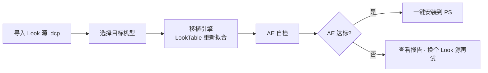
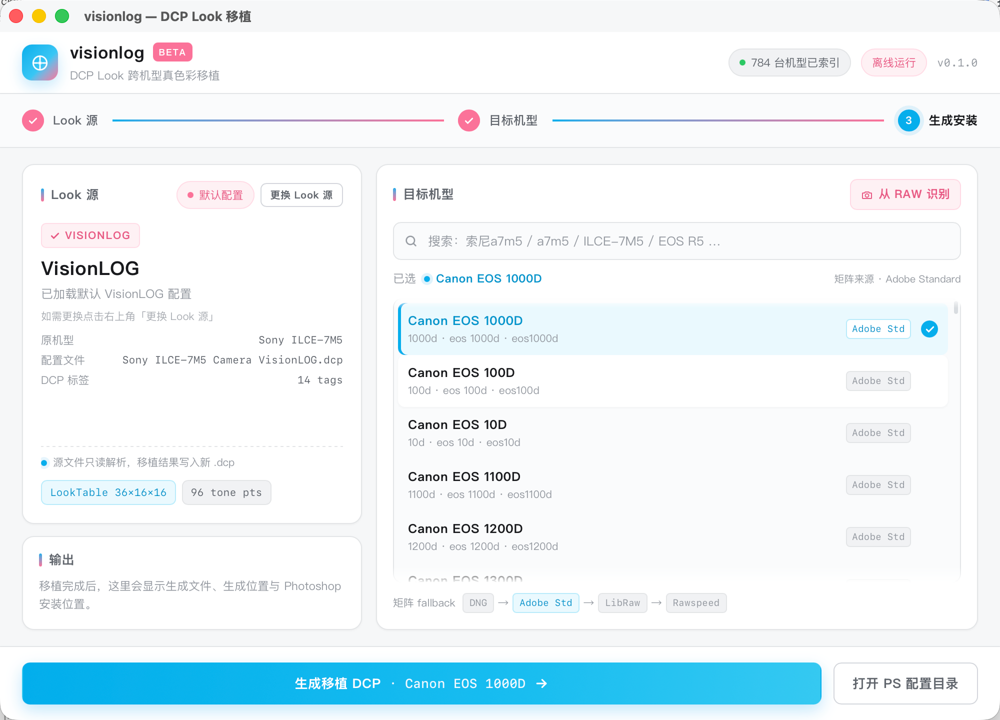
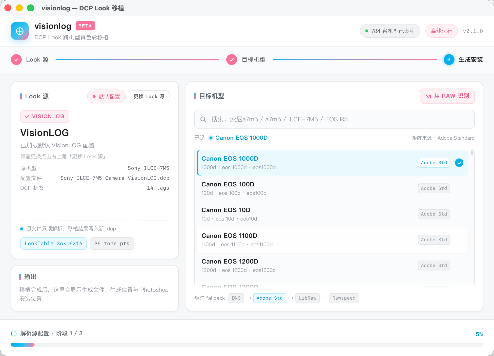
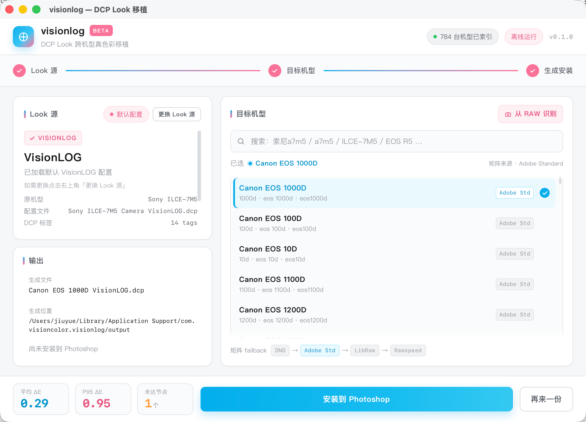
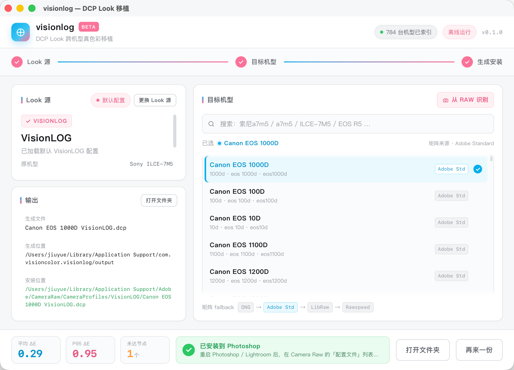

# VisionLog Pro

> DCP Look 跨机型真色彩移植 · macOS / Windows · 全离线

把任意相机 Look 配置文件（如 Sony VisionLOG `.dcp`）**真色彩移植**到任意目标相机机型，生成新的 `.dcp` 并一键装进 Photoshop Camera Raw。

摄影后期用户换了新机身、官方还没出对应机型的 DCP？调色师想让一套 Look 覆盖手头多台机身做一致性？VisionLog Pro 就是为这个问题做的。

---

## 核心特性

- ✅ **真色彩移植** — 用目标机型的真实色彩矩阵重新运算 LookTable，不是简单的标签复制
- 📷 **784 台主流机型索引** — Sony / Canon / Nikon / Fujifilm / Leica / Panasonic / OM System …，支持中文拼音模糊搜索
- 🔍 **三种目标机型输入方式** — 机型搜索 / 拖入 RAW 样片自动识别 / 从 Adobe Standard DCP 自动解析
- 🎯 **4 层矩阵 fallback 链** — DNG 内嵌 → Adobe Standard → LibRaw → Rawspeed XML，保证覆盖率
- 📊 **ΔE 质量自检** — 移植后跑 ΔE76 验证，UI 显示平均 ΔE、P95 ΔE、未达节点数
- 🔌 **一键安装到 Photoshop** — macOS / Windows 自动写入 `CameraProfiles/`，无需管理员权限
- ⚡ **单机型 ≤ 30 秒** — M1 基准
- 🔒 **全离线运行** — 无遥测、无网络依赖，Python 引擎已 PyInstaller 打包进 app
- 📦 **自带默认 VisionLOG** — Sony A7M5 版本随包分发，开箱即用

## 工作流



## 截图

### 1. 选机型 — 三种输入方式

- 内置机型列表（784 台，中文/英文/拼音别名搜索）
- 「从 RAW 识别」— 拖入任意 RAW 样片自动读 EXIF
- 自动显示矩阵来源（Adobe Standard / LibRaw / ...）



### 2. 移植中 — 三阶段实时进度

1. 解析源配置
2. 拟合 LookTable（20 万采样点最小二乘 + Laplacian 平滑）
3. ΔE 质量自检



### 3. 移植完成 — ΔE 报告 + 输出

- 平均 ΔE / P95 ΔE / 未达节点数
- 生成文件、生成位置（可点击复制）
- 等待安装到 Photoshop



### 4. 一键安装到 Photoshop

自动写入 Adobe CameraRaw profile 目录，重启 PS / LR 生效。



## 下载

### macOS

从 [GitHub Releases](https://github.com/iniEvo/app-visionlog/releases) 下载 `.dmg`，双击拖进 Applications。

| 平台 | 架构 | 状态 |
|---|---|---|
| macOS | Apple Silicon | ✅ 已构建 |
| macOS | Intel | 规划中（Tauri universal binary） |
| Windows | x64 | 规划中 |

## 使用

1. 打开 VisionLog Pro，默认已加载自带的 VisionLOG Look
2. 右侧选择目标机型，或拖入一张目标相机的 RAW 样片
3. 点击「生成移植 DCP」
4. 完成后点击「安装到 Photoshop」
5. 重启 Photoshop / Lightroom → Camera Raw 「配置文件」列表里就能看到新生成的 profile

## 开发

### 环境要求

- Node.js ≥ 22
- pnpm ≥ 11
- Rust stable
- macOS: Xcode Command Line Tools

### 启动

```bash
pnpm install
pnpm tauri dev
```

### 打包

```bash
export PATH="$HOME/.cargo/bin:$PATH"
pnpm tauri build
```

产物：

```
src-tauri/target/release/bundle/
├── dmg/VisionLog Pro_<version>_aarch64.dmg
└── macos/VisionLog Pro.app
```

### 项目结构

```
visionlog/
├── src/                  # React + Vite 前端
│   ├── App.tsx           # 单文件 UI
│   ├── ipc.ts            # Tauri IPC 类型 + 封装
│   └── index.css         # Tailwind + 自定义
├── src-tauri/            # Tauri 2 桌面壳
│   ├── src/              # Rust 后端
│   │   ├── cameras.rs    # 784 台机型索引 + 中文别名搜索
│   │   ├── dcp.rs        # DCP 读写解析器
│   │   ├── matrix.rs     # 4 层矩阵 fallback
│   │   ├── sidecar.rs    # Python 移植引擎 sidecar
│   │   ├── install.rs    # Photoshop 安装路径
│   │   └── commands.rs   # Tauri IPC commands
│   ├── binaries/         # 预编译的 visionlog-engine（PyInstaller）
│   └── looks/            # 随包分发的默认 VisionLOG DCP
└── engine/               # Python 移植引擎源码
    ├── main.py           # stdin JSON 请求 / stdout 每行 JSON 事件
    └── pipeline.py       # 移植算法
```

### 移植算法

核心数学：

```
新LookTable = srcLook ∘ srcHSM ∘ (srcStdHSM)⁻¹
再叠矩阵差  M = P⁻¹·FM_src·FM_std⁻¹·P
200k 采样点最小二乘拟合 + 未达节点 Laplacian 平滑
```

算法参考 [extra-sauce](https://github.com/extra-sauce/extra-sauce)（MIT）。

## 已知限制

- 不内置 Adobe Standard DCP 字节（运行时读用户本机已装的，合规）
- 不做 RAW 解码渲染预览（不做 mini-Lightroom）
- 不替用户绕过任何 Look 的版权 — 工具只做转换，不提供盗版 Look 下载
- Windows 版本尚未构建（代码已全平台兼容，CI 待配置）

## 许可证

MIT. 第三方组件：

| 组件 | 许可 |
|---|---|
| [extra-sauce](https://github.com/extra-sauce/extra-sauce) | MIT |
| [Tauri](https://tauri.app) | MIT / Apache 2.0 |
| [React](https://react.dev) | MIT |
| numpy | BSD-3-Clause |

## 致谢

- Adobe 官方 CameraRaw profile 目录约定
- 开源 DCP / LibRaw / Rawspeed 生态

---

<p align="center">
  <sub>app-visionlog · VisionLog Pro · <a href="https://github.com/iniEvo/app-visionlog">GitHub</a></sub>
</p>